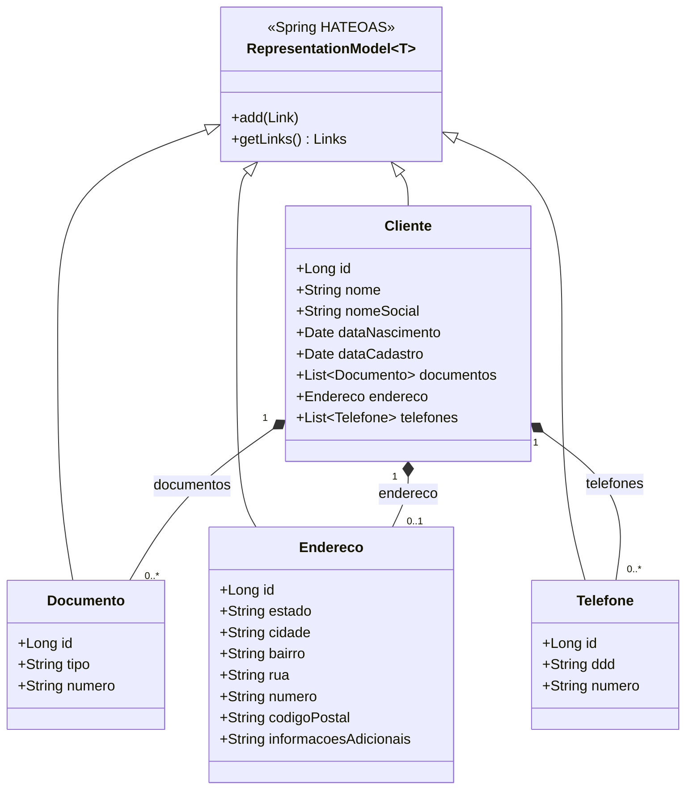

# 🚗 AutoBots — Microsserviço de Gestão de Clientes (`automanager`) — ATVII

[](https://openjdk.org/)
[](https://spring.io/projects/spring-boot)
[-brightgreen)](https://spring.io/projects/spring-hateoas)
[](https://springdoc.org/)
[](https://github.com/Spockchaim/DWIII_AV2)
[](LICENSE)

> **Atividade Prática ATVII (AV2)**  
> **Instituição:** Faculdade de Tecnologia do Estado de São Paulo (FATEC) — São José dos Campos  
> **Curso:** Análise e Desenvolvimento de Sistemas (3º Semestre)  
> **Disciplina:** Desenvolvimento Web III  
> **Docente:** Prof. Dr. Eng. Gerson Penha  

---

## 📖 1. Sobre o Projeto

O **AutoBots** é uma solução em arquitetura de microsserviços voltada à gestão de lojas especializadas em manutenção veicular e comercialização de autopeças. O módulo **`automanager`** é o microsserviço responsável pelo núcleo de cadastro e gerenciamento das informações dos clientes e seus agregados (`Documento`, `Endereco` e `Telefone`).

### 🎯 Objetivos da Atividade (ATVII)
Evoluir a aplicação desenvolvida na ATVI implementando os **quatro níveis de maturidade de Richardson (RMM — Richardson Maturity Model)**:
- **Nível 0 — Uso do protocolo HTTP:** Comunicação padronizada utilizando HTTP/JSON.
- **Nível 1 — URI única por recurso:** Separação clara de recursos em URIs próprias (`/cliente`, `/documento`, `/endereco`, `/telefone`).
- **Nível 2 — Verbos HTTP e Semântica de Status:** Uso semântico dos métodos HTTP (`GET`, `POST`, `PUT`, `DELETE`) combinados aos códigos de status HTTP apropriados (`200 OK`, `201 Created`, `400 Bad Request`, `404 Not Found`, `409 Conflict`) utilizando `ResponseEntity`.
- **Nível 3 — HATEOAS (*Hypermedia as the Engine of Application State*):** Hipermídia dinâmica em todas as respostas de consulta (`_links` / `links`) com `RepresentationModel` e `WebMvcLinkBuilder`, permitindo a navegabilidade autodescritiva da API.

---

## 🏛️ 2. Arquitetura e Estrutura de Pacotes

O projeto adota uma arquitetura em camadas bem definida, separando configuração, entidades JPA com suporte a hipermídia, repositórios de dados, regras de negócio/adicionadores HATEOAS e controladores REST:

```
com.autobots.automanager/
│
├── configuracao/       # Configuração OpenAPI / Swagger UI
│   └── OpenApiConfig.java
│
├── entidades/          # Entidades JPA estendendo RepresentationModel<T>
│   ├── Cliente.java    # Entidade raiz/agregadora
│   ├── Documento.java  # RG, CPF, Passaporte, CNH, etc.
│   ├── Endereco.java   # Endereço residencial/comercial
│   └── Telefone.java   # Contatos telefônicos com DDD
│
├── repositorios/       # Interfaces Spring Data JPA (Data Access Layer)
│   ├── ClienteRepositorio.java
│   ├── DocumentoRepositorio.java
│   ├── EnderecoRepositorio.java
│   └── TelefoneRepositorio.java
│
├── modelos/            # Regras de Negócio e Adicionadores HATEOAS (Domain Services)
│   ├── AdicionadorLink.java
│   ├── AdicionadorLinkCliente.java
│   ├── AdicionadorLinkDocumento.java
│   ├── AdicionadorLinkEndereco.java
│   ├── AdicionadorLinkTelefone.java
│   ├── ClienteAtualizador.java
│   ├── DocumentoAtualizador.java
│   ├── EnderecoAtualizador.java
│   ├── TelefoneAtualizador.java
│   ├── ClienteSelecionador.java
│   ├── DocumentoSelecionador.java
│   ├── EnderecoSelecionador.java
│   ├── TelefoneSelecionador.java
│   └── StringVerificadorNulo.java
│
└── controles/          # Camada REST (Endpoints da API — RMM Níveis 0 a 3)
    ├── ClienteControle.java
    ├── DocumentoControle.java
    ├── EnderecoControle.java
    └── TelefoneControle.java
```

### 🧩 Diagrama de Relacionamento das Entidades (HATEOAS)



---

## 🌐 3. Documentação da API REST e HATEOAS

Todos os endpoints respondem em `http://localhost:8080`.

### 👤 Endpoints de Cliente (`/cliente`)
| Método | Endpoint | Descrição | Status Sucesso / Erro |
| :--- | :--- | :--- | :---: |
| `POST` | `/cliente/cadastro` | Cadastra um novo cliente (com endereço, docs e telefones) | `201 Created` / `409 Conflict` |
| `GET` | `/cliente/clientes` (ou `/clientes`) | Lista todos os clientes cadastrados com links HATEOAS | `200 OK` / `404 Not Found` |
| `GET` | `/cliente/{id}` | Busca cliente específico pelo ID com links HATEOAS | `200 OK` / `404 Not Found` |
| `PUT` | `/cliente/atualizar` | Atualiza dados cadastrais do cliente e dependentes | `200 OK` / `400` / `404` |
| `DELETE` | `/cliente/excluir/{id}` (ou `/cliente/excluir`) | Remove cliente e dispara **exclusão em cascata** | `200 OK` / `400` / `404` |

### 📄 Endpoints de Documento (`/documento`)
| Método | Endpoint | Descrição | Status Sucesso / Erro |
| :--- | :--- | :--- | :---: |
| `POST` | `/documento/cadastro` | Cadastra um documento avulso | `201 Created` / `409 Conflict` |
| `GET` | `/documento/documentos` (ou `/documentos`) | Lista todos os documentos com links HATEOAS | `200 OK` / `404 Not Found` |
| `GET` | `/documento/{id}` | Busca documento por ID com links HATEOAS | `200 OK` / `404 Not Found` |
| `PUT` | `/documento/atualizar` | Atualiza tipo ou número de um documento | `200 OK` / `400` / `404` |
| `DELETE` | `/documento/excluir/{id}` (ou `/documento/excluir`) | Remove documento (desvinculando do cliente pai) | `200 OK` / `400` / `404` |

### 📍 Endpoints de Endereço (`/endereco`)
| Método | Endpoint | Descrição | Status Sucesso / Erro |
| :--- | :--- | :--- | :---: |
| `POST` | `/endereco/cadastro` | Cadastra um endereço avulso | `201 Created` / `409 Conflict` |
| `GET` | `/endereco/enderecos` (ou `/enderecos`) | Lista todos os endereços com links HATEOAS | `200 OK` / `404 Not Found` |
| `GET` | `/endereco/{id}` | Busca endereço por ID com links HATEOAS | `200 OK` / `404 Not Found` |
| `PUT` | `/endereco/atualizar` | Atualiza campos de endereço | `200 OK` / `400` / `404` |
| `DELETE` | `/endereco/excluir/{id}` (ou `/endereco/excluir`) | Remove endereço (desvinculando do cliente) | `200 OK` / `400` / `404` |

### 📞 Endpoints de Telefone (`/telefone`)
| Método | Endpoint | Descrição | Status Sucesso / Erro |
| :--- | :--- | :--- | :---: |
| `POST` | `/telefone/cadastro` | Cadastra um telefone avulso | `201 Created` / `409 Conflict` |
| `GET` | `/telefone/telefones` (ou `/telefones`) | Lista todos os telefones com links HATEOAS | `200 OK` / `404 Not Found` |
| `GET` | `/telefone/{id}` | Busca telefone por ID com links HATEOAS | `200 OK` / `404 Not Found` |
| `PUT` | `/telefone/atualizar` | Atualiza DDD ou número de telefone | `200 OK` / `400` / `404` |
| `DELETE` | `/telefone/excluir/{id}` (ou `/telefone/excluir`) | Remove telefone (desvinculando do cliente pai) | `200 OK` / `400` / `404` |

---

## 🔗 4. Exemplos de Payloads e Respostas JSON com HATEOAS

### Resposta de Consulta por ID com HATEOAS (`GET /cliente/1`)
```json
{
  "id": 1,
  "nome": "Pedro de Alcântara Francisco Antônio João Carlos Xavier de Paula Miguel Rafael Joaquim José Gonzaga Pascoal Cipriano Serafim de Bragança e Bourbon",
  "nomeSocial": "Dom Pedro I",
  "dataNascimento": "1798-10-12T00:00:00.000+00:00",
  "dataCadastro": "2026-10-18T00:00:00.000+00:00",
  "documentos": [
    {
      "id": 1,
      "tipo": "RG",
      "numero": "1500",
      "_links": {
        "self": { "href": "http://localhost:8080/documento/1" },
        "documentos": { "href": "http://localhost:8080/documento/documentos" },
        "atualizar": { "href": "http://localhost:8080/documento/atualizar" },
        "excluir": { "href": "http://localhost:8080/documento/excluir/1" }
      }
    }
  ],
  "endereco": {
    "id": 1,
    "estado": "Rio de Janeiro",
    "cidade": "Rio de Janeiro",
    "bairro": "São Cristóvão",
    "rua": "Quinta da Boa Vista",
    "numero": "S/N",
    "codigoPostal": "20940040",
    "informacoesAdicionais": "Palácio Imperial",
    "_links": {
      "self": { "href": "http://localhost:8080/endereco/1" },
      "enderecos": { "href": "http://localhost:8080/endereco/enderecos" },
      "atualizar": { "href": "http://localhost:8080/endereco/atualizar" },
      "excluir": { "href": "http://localhost:8080/endereco/excluir/1" }
    }
  },
  "telefones": [
    {
      "id": 1,
      "ddd": "21",
      "numero": "981234576",
      "_links": {
        "self": { "href": "http://localhost:8080/telefone/1" },
        "telefones": { "href": "http://localhost:8080/telefone/telefones" },
        "atualizar": { "href": "http://localhost:8080/telefone/atualizar" },
        "excluir": { "href": "http://localhost:8080/telefone/excluir/1" }
      }
    }
  ],
  "_links": {
    "self": { "href": "http://localhost:8080/cliente/1" },
    "clientes": { "href": "http://localhost:8080/cliente/clientes" },
    "atualizar": { "href": "http://localhost:8080/cliente/atualizar" },
    "excluir": { "href": "http://localhost:8080/cliente/excluir/1" }
  }
}
```

### Cadastro Completo de Cliente (`POST /cliente/cadastro`)
```json
{
  "nome": "Alberto Santos Dumont",
  "nomeSocial": "Santos Dumont",
  "dataNascimento": "1873-07-20T00:00:00.000+00:00",
  "dataCadastro": "2026-10-18T00:00:00.000+00:00",
  "endereco": {
    "estado": "Minas Gerais",
    "cidade": "Palmira",
    "bairro": "Cabangu",
    "rua": "Estrada Fazenda Cabangu",
    "numero": "S/N",
    "codigoPostal": "36240000",
    "informacoesAdicionais": "Museu de Cabangu"
  },
  "documentos": [
    {
      "tipo": "PASSAPORTE",
      "numero": "BR1906"
    },
    {
      "tipo": "CPF",
      "numero": "11122233344"
    }
  ],
  "telefones": [
    {
      "ddd": "32",
      "numero": "999887766"
    }
  ]
}
```

---

## 🛠️ 5. Principais Evoluções e Melhorias Técnicas

1. **Maturidade RMM Nível 3 (HATEOAS Completo):**
   - Todas as 4 entidades (`Cliente`, `Documento`, `Endereco`, `Telefone`) estendem `RepresentationModel<T>` utilizando `@Getter` e `@Setter`.
   - Implementados adicionadores de links dedicados (`AdicionadorLinkCliente`, `AdicionadorLinkDocumento`, `AdicionadorLinkEndereco`, `AdicionadorLinkTelefone`) baseados na interface genérica `AdicionadorLink<T>`.
   - Ao consultar um `Cliente`, seus sub-recursos aninhados (`endereco`, `documentos` e `telefones`) também recebem automaticamente seus próprios links HATEOAS.
2. **Documentação Interativa com Swagger / OpenAPI 3:**
   - Configurada via `springdoc-openapi-ui` e `OpenApiConfig`, com anotações `@Tag` e `@Operation` detalhando cada endpoint.
3. **Correções Herdadas e Robustez (ATVI + ATVII):**
   - Carga inicial (`Runner`) idempotente com 3 clientes históricos completos e encoding UTF-8 corrigido.
   - Atualização do campo `codigoPostal` em `EnderecoAtualizador`.
   - Comparação segura de IDs (`Long`) com `.equals()` em todos os selecionadores e atualizadores.
   - Compatibilidade com Java 17 e Java 21 (`<lombok.version>1.18.30</lombok.version>`).

---

## 🚀 6. Como Executar a Aplicação

### Passo a passo
1. Acesse a pasta do microsserviço (`automanager`):
   ```bash
   cd automanager
   ```
2. Inicie a aplicação com o Maven Wrapper:
   - **Linux/macOS:**
     ```bash
     ./mvnw spring-boot:run
     ```
   - **Windows:**
     ```cmd
     mvnw.cmd spring-boot:run
     ```
3. Acesse os recursos no navegador:
   - **API Base:** `http://localhost:8080`
   - **Swagger UI (Documentação Interativa):** `http://localhost:8080/swagger-ui.html`
   - **OpenAPI JSON:** `http://localhost:8080/v3/api-docs`
   - **Console do Banco H2:** `http://localhost:8080/h2-console` (`JDBC URL`: `jdbc:h2:mem:automanagerdb` | `Usuário`: `sa` | `Senha`: *(vazio)*)

---

## 🧪 7. Testes Automatizados e Validação

O projeto conta com uma suíte de **18 testes automatizados** com JUnit 5 e Spring MockMvc (`src/test/java/com/autobots/automanager/Fase6EndpointsTest.java`), validando todas as operações CRUD, exclusão em cascata, códigos HTTP, links HATEOAS (`_links`) e disponibilidade do Swagger:

```bash
./mvnw test
```

**Resultado:**
```text
[INFO] Results:
[INFO] 
[INFO] Tests run: 18, Failures: 0, Errors: 0, Skipped: 0
[INFO] 
[INFO] ------------------------------------------------------------------------
[INFO] BUILD SUCCESS
[INFO] ------------------------------------------------------------------------
```
